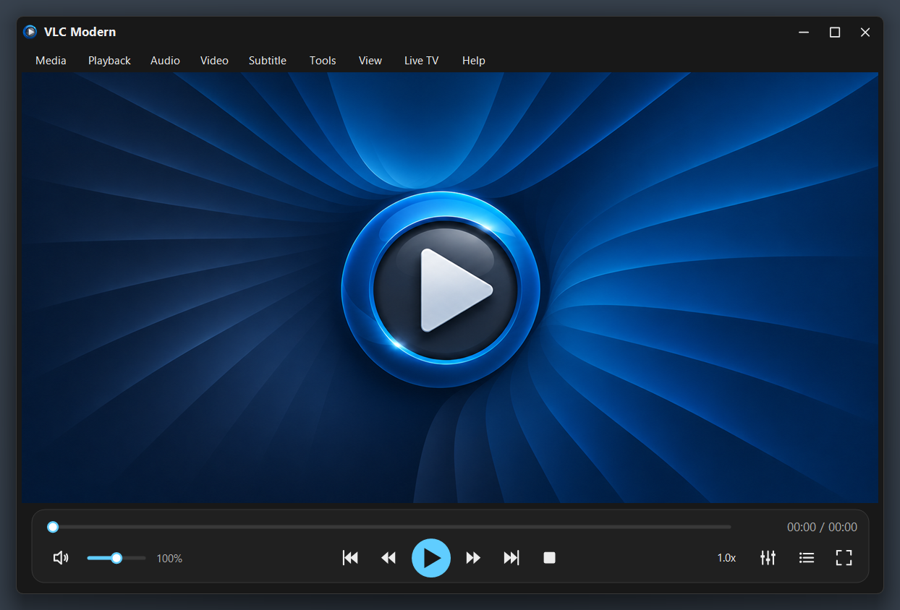
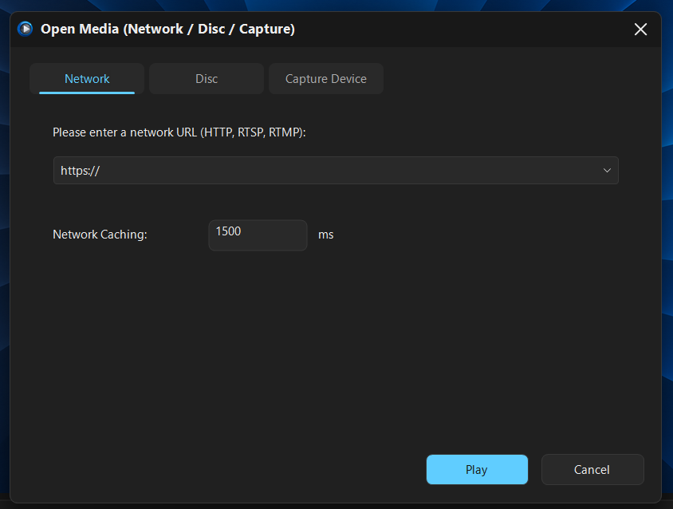
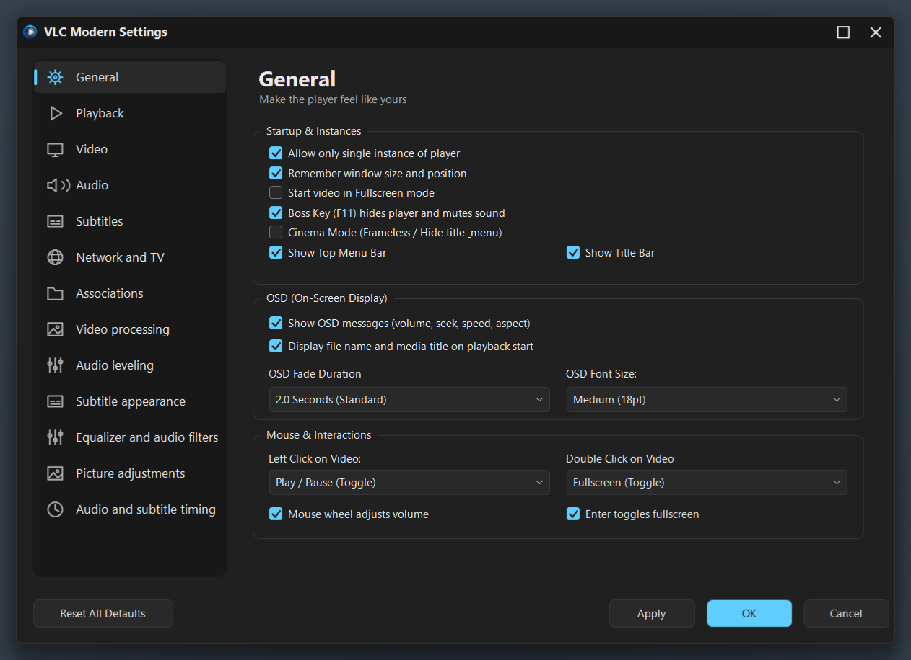
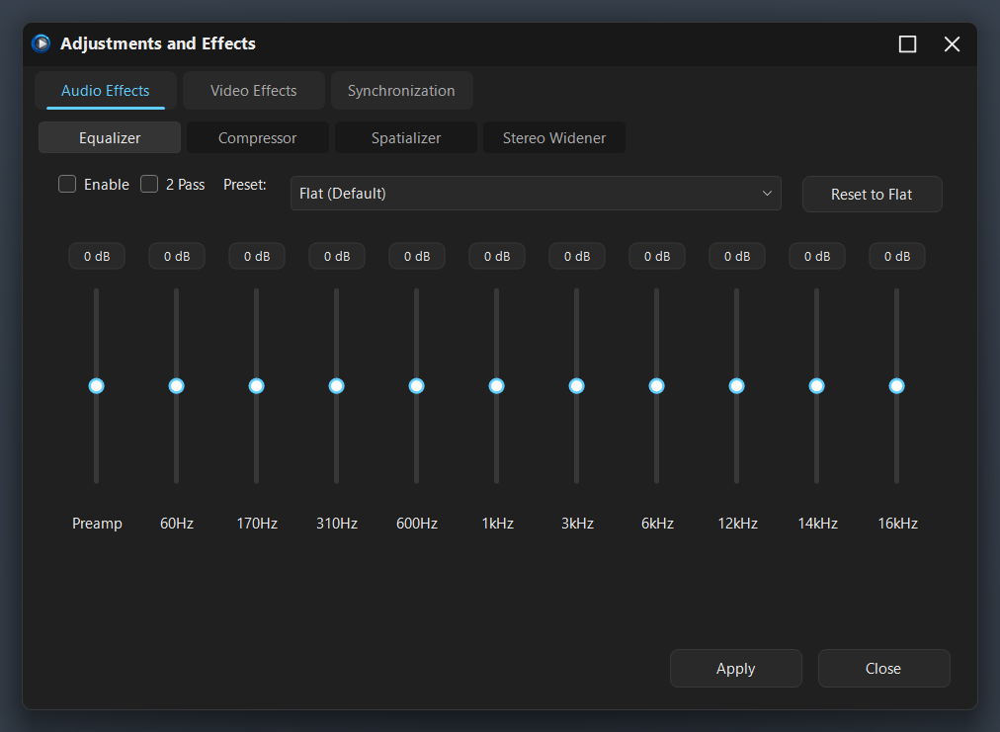
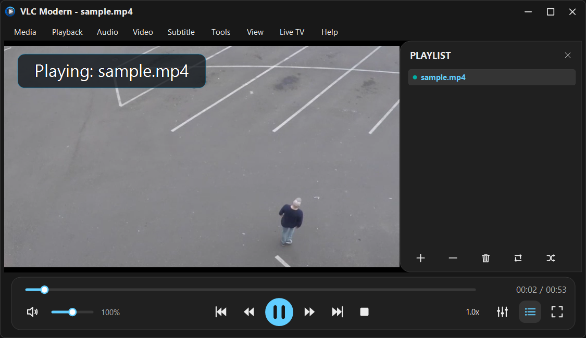
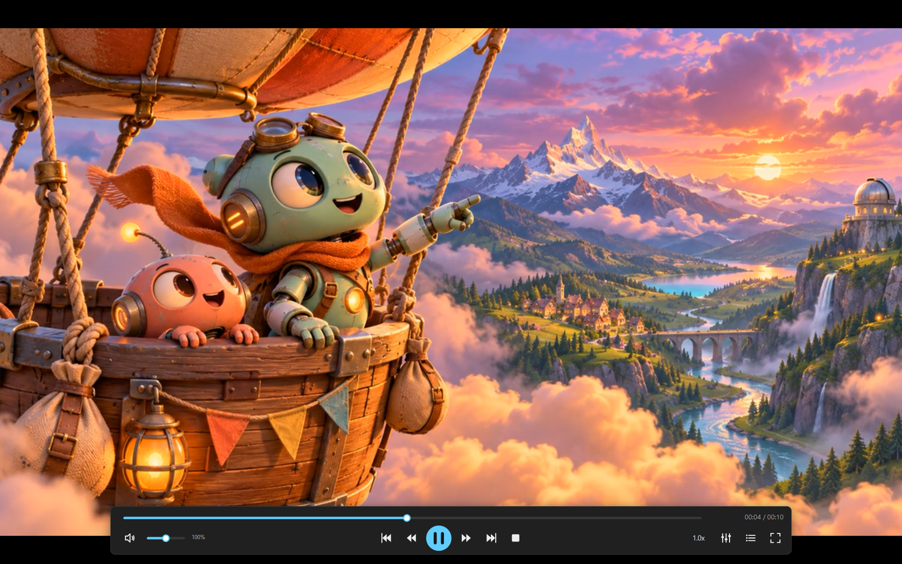
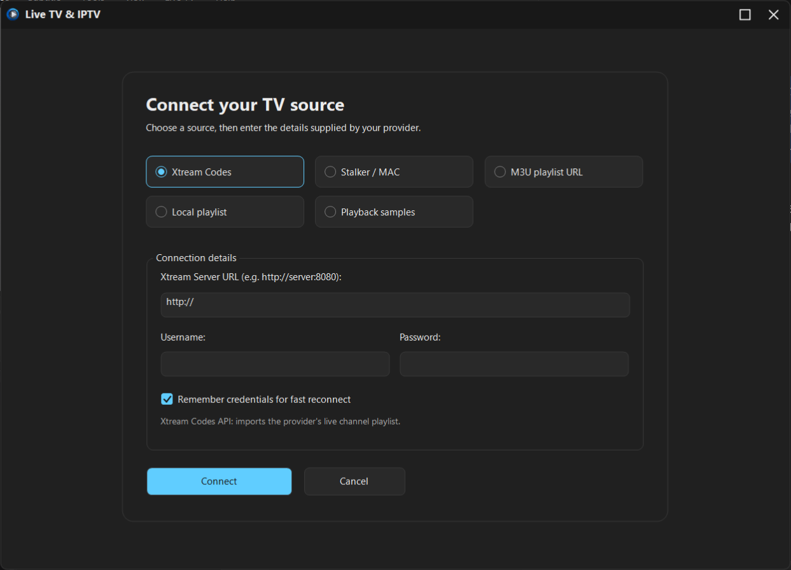

<p align="center"></p>
<h1 align="center">VLC Modern</h1>
<p align="center">A native Windows media player built with Delphi, VCL, and LibVLC.</p>
<p align="center"><a href="README_AR.md">العربية</a> · <a href="#screenshots">Screenshots</a> · <a href="#build-from-source">Build from source</a> · <a href="https://github.com/Diagoo1/VLC-Modern/issues/new">Report an issue</a></p>

<p align="center"><a href="https://github.com/Diagoo1/VLC-Modern/releases/download/v0.1.0/VLC-Modern-v0.1.0-Windows-x86.zip"></a></p>
<p align="center"><a href="https://github.com/Diagoo1/VLC-Modern/releases/download/v0.1.0/VLC-Modern-v0.1.0-Windows-x86.zip">Download for Windows (ZIP)</a> · <a href="https://github.com/Diagoo1/VLC-Modern/releases/tag/v0.1.0">v0.1.0</a></p>

---

## Screenshots



**Main player.** The VLC Modern splash screen on startup, with the rounded control dock below.

| Opening media | Preferences | Audio effects |
| --- | --- | --- |
|  |  |  |
| Network streams, discs, and capture devices. | Sidebar navigation and playback preferences. | Presets, preamp, and individual frequency bands. |

| Playlist | Fullscreen | Live TV and IPTV |
| --- | --- | --- |
|  |  |  |
| Docked queue with the active item highlighted. | Rounded floating dock over the video. | Source selection and connection fields. |

[Browse full-size screenshots and captions →](docs/SCREENSHOTS.md)

## Features

| Area | Features |
| --- | --- |
| Playback | Local media, network streams, playlists, playback speed, and fullscreen controls |
| Audio and video | Equalizer, audio filters, and picture adjustments |
| Subtitles | Track selection, external subtitle files, and synchronization |
| Live TV | IPTV source setup and playlist import |
| Windows interface | Dark dialogs, custom menus, seek preview, and taskbar playback controls |

## Build from source

1. Install Delphi 13 with its Win32 compiler, Windows SDK, and PowerShell 7.
2. Put `dcc32` on PATH and run `build.bat` from the repository root.
3. Place the matching **32-bit LibVLC** runtime files beside the executable.

```text
bin/
  VLCModern.exe
  libvlc.dll
  libvlccore.dll
  plugins/
```

Obtain the runtime from [VideoLAN](https://www.videolan.org/vlc/).

## Project layout

| Path | Contents |
| --- | --- |
| `src/core` | Playback integration and settings |
| `src/forms` | Main window and dialogs |
| `src/ui` | Custom controls, menus, and rendering |
| `res` | Application icon, startup artwork, and embedded layouts |
| `tools` | Build scripts |

VLC Modern is an independent project that uses VideoLAN’s LibVLC.
