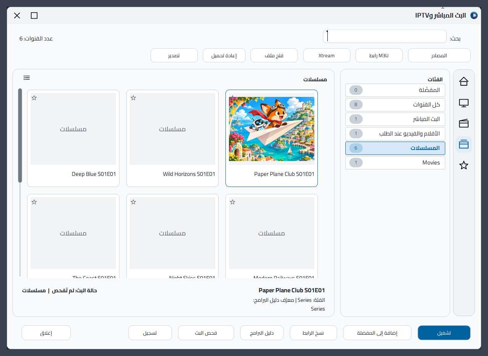
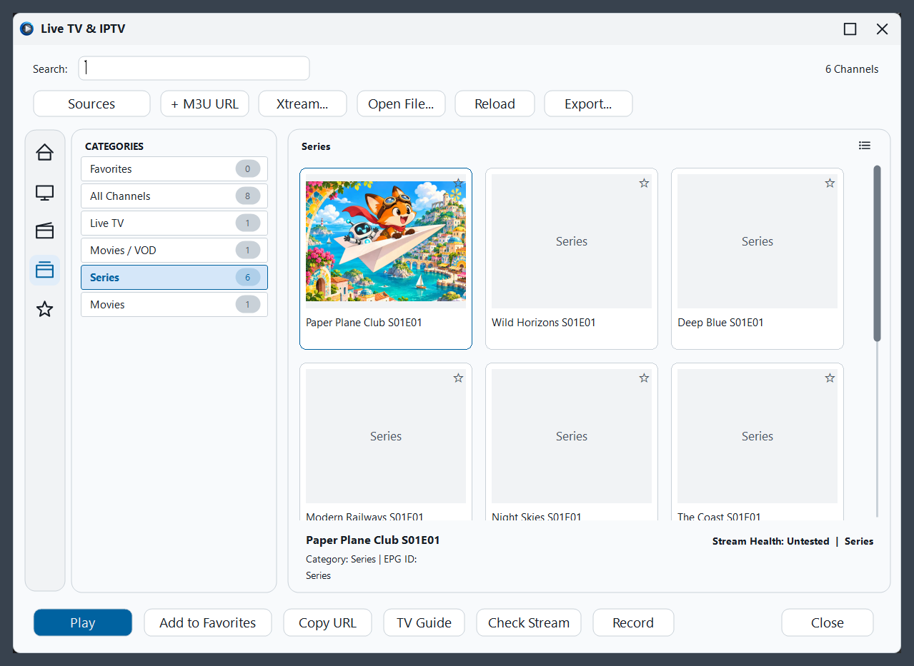
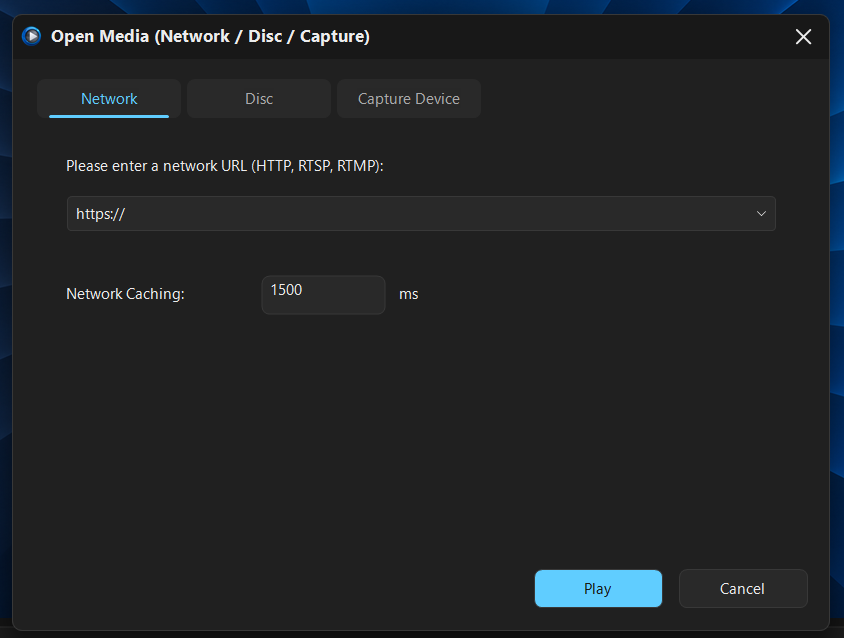

<h1 align="center">VLC Modern</h1>

مشغّل وسائط لويندوز مبني باستخدام Delphi وVCL وLibVLC.

 &nbsp;·&nbsp; <a href="https://diagoo1.github.io/VLC-Modern/#screenshots"><strong>معرض الصور</strong></a> &nbsp;·&nbsp; <a href="https://diagoo1.github.io/VLC-Modern/#download"><strong>التحميل</strong></a>

     

<blockquote dir="rtl" align="right"><strong>الإصدار الرسمي v1.0.12.</strong> اختر EXE للتثبيت في Program Files أو ZIP محمول للتشغيل بعد فك الضغط.</blockquote>

<a href="https://github.com/Diagoo1/VLC-Modern/releases/download/v1.0.12/VLC-Modern-v1.0.12-Setup-Full-Windows.exe"><strong>تثبيت Full &#183; EXE</strong></a> &nbsp;·&nbsp; <a href="https://github.com/Diagoo1/VLC-Modern/releases/download/v1.0.12/VLC-Modern-v1.0.12-Portable-Full-Windows.zip"><strong>محمول Full &#183; ZIP</strong></a>

<a href="https://github.com/Diagoo1/VLC-Modern/releases/download/v1.0.12/VLC-Modern-v1.0.12-Setup-Lite-Windows.exe"><strong>تثبيت Lite &#183; EXE</strong></a> &nbsp;·&nbsp; <a href="https://github.com/Diagoo1/VLC-Modern/releases/download/v1.0.12/VLC-Modern-v1.0.12-Portable-Lite-Windows.zip"><strong>محمول Lite &#183; ZIP</strong></a>

نسخة Lite بتشغّل الملفات المحلية الشائعة فورًا. تقدر تنزّل مجموعة الإضافات الكاملة وFFmpeg أثناء التثبيت أو بعده. لو انقطع الاتصال، يكتمل تثبيت المشغّل وتقدر تعيد المحاولة من الإعدادات ← Components.

<ul dir="rtl">
  <li><strong>Full</strong> تشمل إضافات تشغيل LibVLC وFFmpeg للقص الدقيق على ويندوز 64 بت.</li>
  <li><strong>Lite</strong> تشمل المشغّل وملفات DLL الأساسية. ثبّت إضافات LibVLC لتشغيل الوسائط، واختر FFmpeg بشكل منفصل للقص الدقيق.</li>
  <li><strong>YouTube</strong> النسختين بيشغّلوا YouTube بالبث المباشر باستخدام QuickJS‑NG المرفق. Node.js بديل اختياري في <strong>Settings → Playback Components</strong>.</li>
  <li><strong>الإعدادات ← Playback Components</strong> تفتح نافذة تثبيت المكوّنات ومزامنتها. أعد تشغيل المشغّل بعد تثبيت أو تحديث إضافات LibVLC.</li>
</ul>

<a href="https://diagoo1.github.io/VLC-Modern/#download"><strong>تحميل لويندوز</strong></a> &nbsp;·&nbsp; <a href="https://github.com/Diagoo1/VLC-Modern/issues/new"><strong>الإبلاغ عن خطأ</strong></a> &nbsp;·&nbsp; 

## صور البرنامج

**واجهة المشغّل.** شاشة البداية بهوية VLC Modern، وأسفلها شريط التحكم بحوافه المستديرة.

| الإعدادات | المؤثرات الصوتية |
| --- | --- |
|  |  |
| زرا Components وReset بمحاذاة القائمة الجانبية. | إعدادات جاهزة وتحكم في كل نطاق ترددي. |

| قائمة التشغيل | ملء الشاشة |
| --- | --- |
|  |  |
| قائمة جانبية تبرز الملف الجاري تشغيله. | شريط تحكم عائم بحواف مستديرة فوق الفيديو. |

### الوضع الفاتح

**واجهة التشغيل.** الوضع الفاتح يظهر في شريط العنوان والقوائم وأدوات التشغيل، مع الحفاظ على ألوان الفيديو.

| الإعدادات | الإكولايزر |
| --- | --- |
|  |  |
| اختيار السمة ومكوّنات التشغيل. | الإعدادات المسبقة والمضخّم والتحكم في كل نطاق ترددي. |

من **الإعدادات ← عام ← السمة**، تقدر تختار **فاتح** أو **داكن** أو **اتباع النظام**. الخيار الافتراضي هو **اتباع النظام**، وتُطبّق السمة عند إعادة تشغيل المشغّل.

### البث وIPTV وتحويل الوسائط

| واجهة IPTV بالعربية | واجهة IPTV بالإنجليزية |
| --- | --- |
|  |  |

اضغط على أي لقطة لفتحها بالحجم الكامل.

| البث التلفزيوني وIPTV | فتح بث شبكي | تحويل الوسائط |
| --- | --- | --- |
|  |  |  |
| اتصل بمزوّد Xtream Codes أو Stalker / MAC، أو افتح رابط M3U أو ملفًا محليًا، أو جرّب عينات التشغيل. | افتح مصدر HTTP أو RTSP أو RTMP واضبط التخزين المؤقت للشبكة. تبويبات منفصلة للأقراص وأجهزة الالتقاط. | اختَر ملفًا أو رابطًا، وصيغة الإخراج، ومكان الحفظ. اللقطة بتوضح H.264 + AAC داخل MP4. |

استخدمنا [IPTVnator](https://github.com/4gray/iptvnator) مرجعًا لتجربة إضافة مصادر IPTV. اللقطات اللي فوق من VLC Modern، وتقدر تشوف واجهة المشروع المرجعي ومميزاته على [موقع IPTVnator](https://4gray.github.io/iptvnator/).

[معرض الصور بالحجم الكامل](docs/SCREENSHOTS.md)

يدعم المشغّل الملفات المحلية وبث الشبكة وقوائم التشغيل وIPTV والترجمة الخارجية، مع إكولايزر وأدوات لضبط الصورة والصوت.

## البناء والتشغيل

ثبّت Delphi 13 مع مترجم Win32، وWindows SDK، وPowerShell 7. أضف `dcc32` إلى PATH وشغّل `build.bat` من جذر المشروع. يحتاج التشغيل إلى LibVLC إصدار 32 بت، مع وضع `libvlc.dll` و`libvlccore.dll` ومجلد `plugins` بجانب البرنامج في `bin`.

[تعليمات البناء وتنظيم السورس](README.md#build-from-source)
