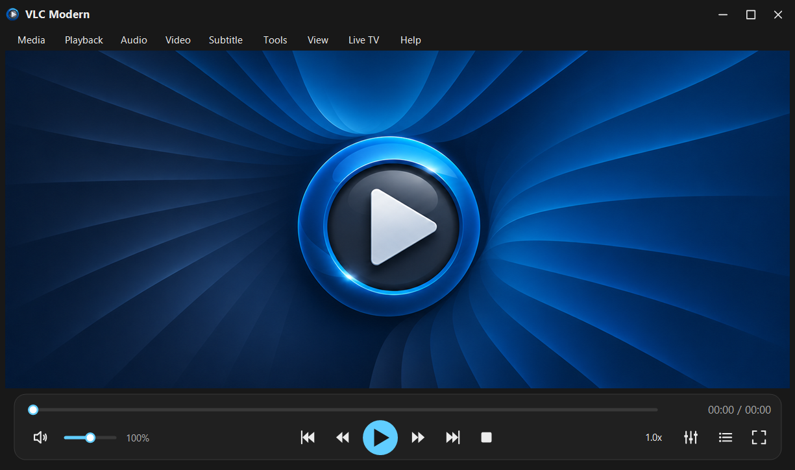
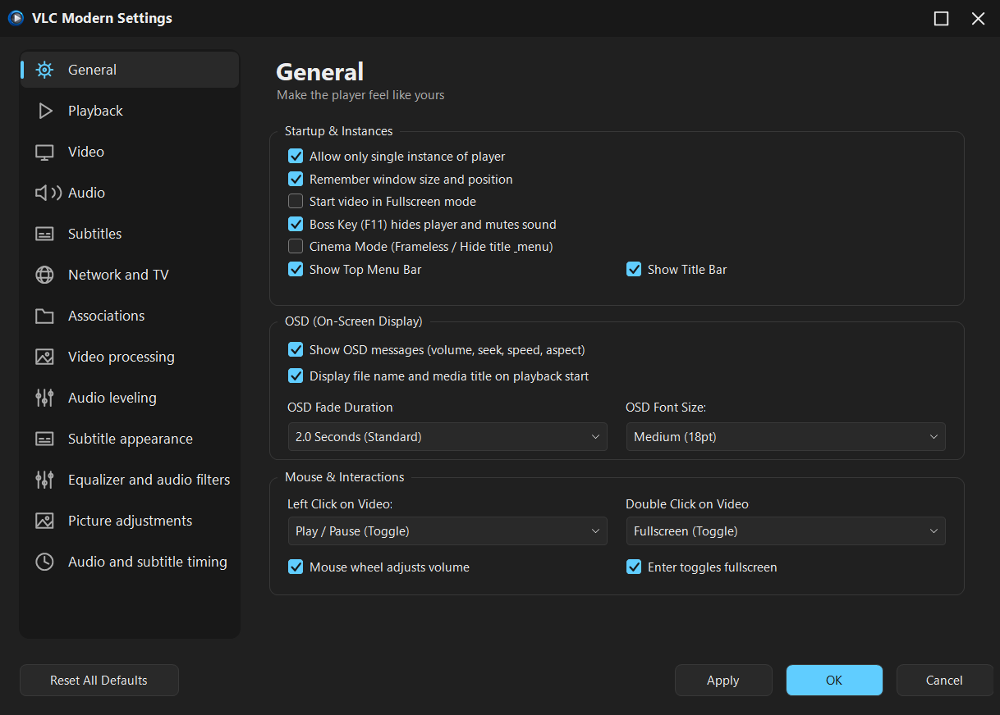
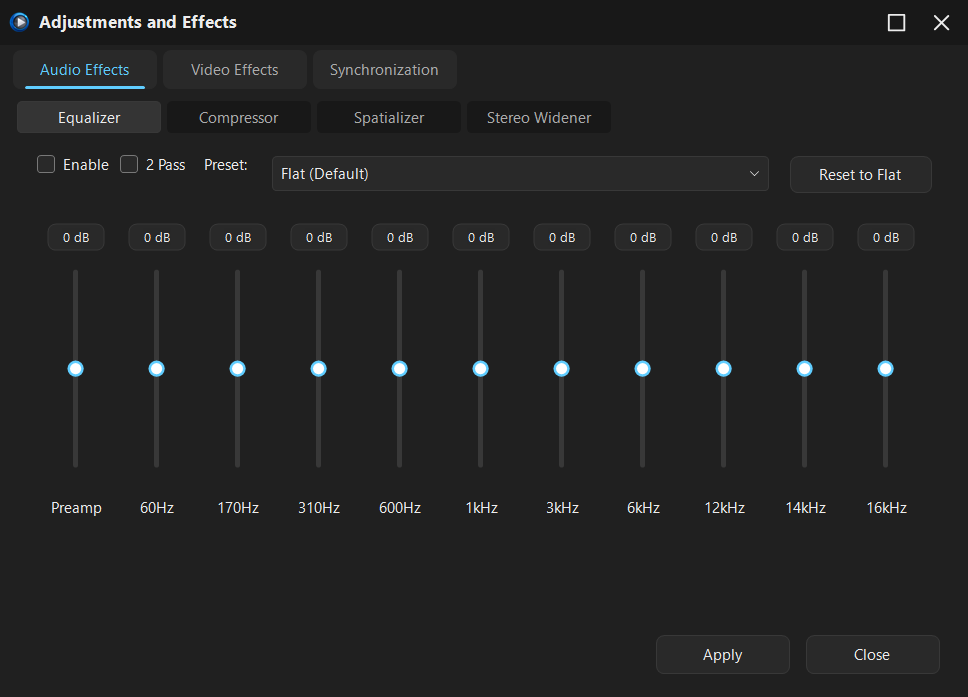

<h1 align="center">VLC Modern</h1>

مشغّل وسائط لويندوز مبني باستخدام Delphi وVCL وLibVLC.

<a href="README.md">English</a> · <a href="https://github.com/Diagoo1/VLC-Modern/issues/new">الإبلاغ عن مشكلة</a>

## صور البرنامج

**واجهة المشغّل.** مساحة العرض بالأعلى، وأسفلها شريط التقدّم وأزرار التشغيل والصوت والسرعة وقائمة التشغيل وملء الشاشة.

| فتح الوسائط | الإعدادات | المؤثرات الصوتية |
| --- | --- | --- |
|  |  |  |
| بث الشبكة والأقراص وأجهزة الالتقاط. | قائمة جانبية لتنظيم خيارات المشغّل. | إعدادات جاهزة وتحكم في كل نطاق ترددي. |

[معرض الصور بالحجم الكامل](docs/SCREENSHOTS.md)

يدعم المشغّل الملفات المحلية وبث الشبكة وقوائم التشغيل وIPTV والترجمة الخارجية، مع إكولايزر وأدوات لضبط الصورة والصوت.

## البناء والتشغيل

ثبّت Delphi 13 مع مترجم Win32، وWindows SDK، وPowerShell 7. أضف `dcc32` إلى PATH وشغّل `build.bat` من جذر المشروع. يحتاج التشغيل إلى LibVLC إصدار 32 بت، مع وضع `libvlc.dll` و`libvlccore.dll` ومجلد `plugins` بجانب البرنامج في `bin`.

[تعليمات البناء وتنظيم السورس](README.md#build-from-source)
