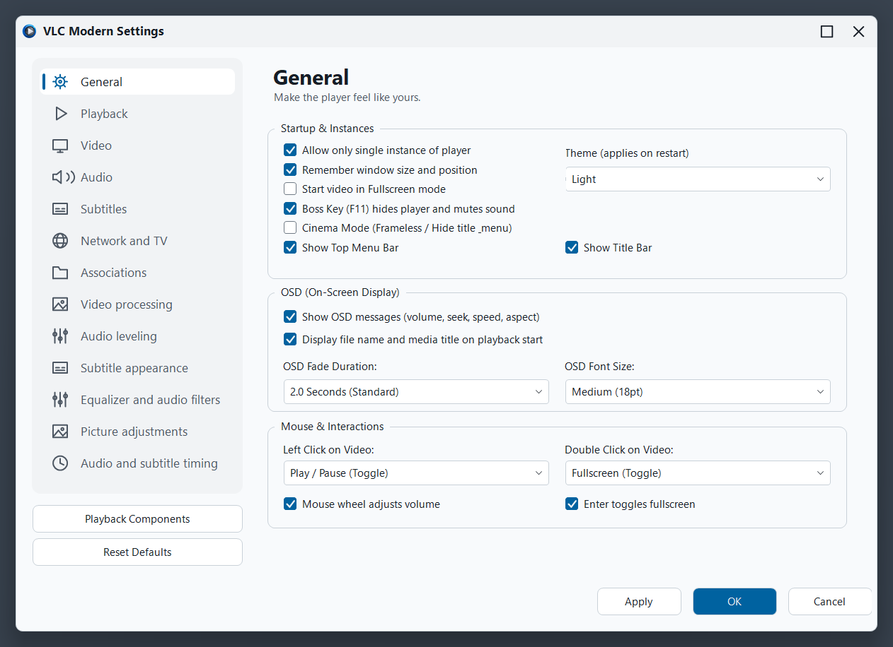

<h1 align="center">VLC Modern</h1>

مشغّل وسائط لويندوز مبني باستخدام Delphi وVCL وLibVLC.

<a href="README.md">English</a> · <a href="https://github.com/Diagoo1/VLC-Modern/issues/new">الإبلاغ عن مشكلة</a>

     

> **Public Beta · نسخة تجريبية عامة.** البرنامج لسه تحت التطوير، وممكن تقابل أخطاء أو ميزات غير مكتملة. النسخة متاحة للتجربة وإرسال الملاحظات.

 

<a href="https://github.com/Diagoo1/VLC-Modern/releases/download/v0.1.0/VLC-Modern-v0.1.0-Public-Beta-Lite-Windows.zip"><strong>تحميل Lite</strong></a>

- **Full** تشمل إضافات تشغيل LibVLC وFFmpeg للقص الدقيق على ويندوز 64 بت.
- **Lite** تشمل المشغّل وملفات DLL الأساسية. ثبّت إضافات LibVLC لتشغيل الوسائط، واختر FFmpeg بشكل منفصل للقص الدقيق.
- **YouTube** يستخدم Node.js المحمول المرفق في النسختين على ويندوز 64 بت، من غير تثبيت يدوي.
- **الإعدادات ← Playback Components** تفتح نافذة تثبيت المكوّنات ومزامنتها. أعد تشغيل المشغّل بعد تثبيت أو تحديث إضافات LibVLC.

<a href="https://github.com/Diagoo1/VLC-Modern/releases/download/v0.1.0/VLC-Modern-v0.1.0-Public-Beta-Full-Windows.zip">تحميل نسخة ويندوز</a> · <a href="https://github.com/Diagoo1/VLC-Modern/issues/new">الإبلاغ عن خطأ</a> · <a href="https://github.com/Diagoo1/VLC-Modern/releases/tag/v0.1.0">v0.1.0 Beta</a>

## صور البرنامج

**واجهة المشغّل.** شاشة البداية بهوية VLC Modern، وأسفلها شريط التحكم بحوافه المستديرة.

| فتح الوسائط | الإعدادات | المؤثرات الصوتية |
| --- | --- | --- |
|  |  |  |
| بث الشبكة والأقراص وأجهزة الالتقاط. | قائمة جانبية لتنظيم خيارات المشغّل. | إعدادات جاهزة وتحكم في كل نطاق ترددي. |

| قائمة التشغيل | ملء الشاشة | Live TV وIPTV |
| --- | --- | --- |
|  |  |  |
| قائمة جانبية تبرز الملف الجاري تشغيله. | شريط تحكم عائم بحواف مستديرة فوق الفيديو. | اختيار المصدر وإعداد الاتصال. |

### الوضع الفاتح

**واجهة التشغيل.** الوضع الفاتح يظهر في شريط العنوان والقوائم وأدوات التشغيل، مع الحفاظ على ألوان الفيديو.

| الإعدادات | الإكولايزر |
| --- | --- |
|  |  |
| اختيار السمة ومكوّنات التشغيل. | الإعدادات المسبقة والمضخّم والتحكم في كل نطاق ترددي. |

من **الإعدادات ← عام ← السمة**، تقدر تختار **فاتح** أو **داكن** أو **اتباع النظام**. الخيار الافتراضي هو **اتباع النظام**، وتُطبّق السمة عند إعادة تشغيل المشغّل.

[معرض الصور بالحجم الكامل](docs/SCREENSHOTS.md)

يدعم المشغّل الملفات المحلية وبث الشبكة وقوائم التشغيل وIPTV والترجمة الخارجية، مع إكولايزر وأدوات لضبط الصورة والصوت.

## البناء والتشغيل

ثبّت Delphi 13 مع مترجم Win32، وWindows SDK، وPowerShell 7. أضف `dcc32` إلى PATH وشغّل `build.bat` من جذر المشروع. يحتاج التشغيل إلى LibVLC إصدار 32 بت، مع وضع `libvlc.dll` و`libvlccore.dll` ومجلد `plugins` بجانب البرنامج في `bin`.

[تعليمات البناء وتنظيم السورس](README.md#build-from-source)
