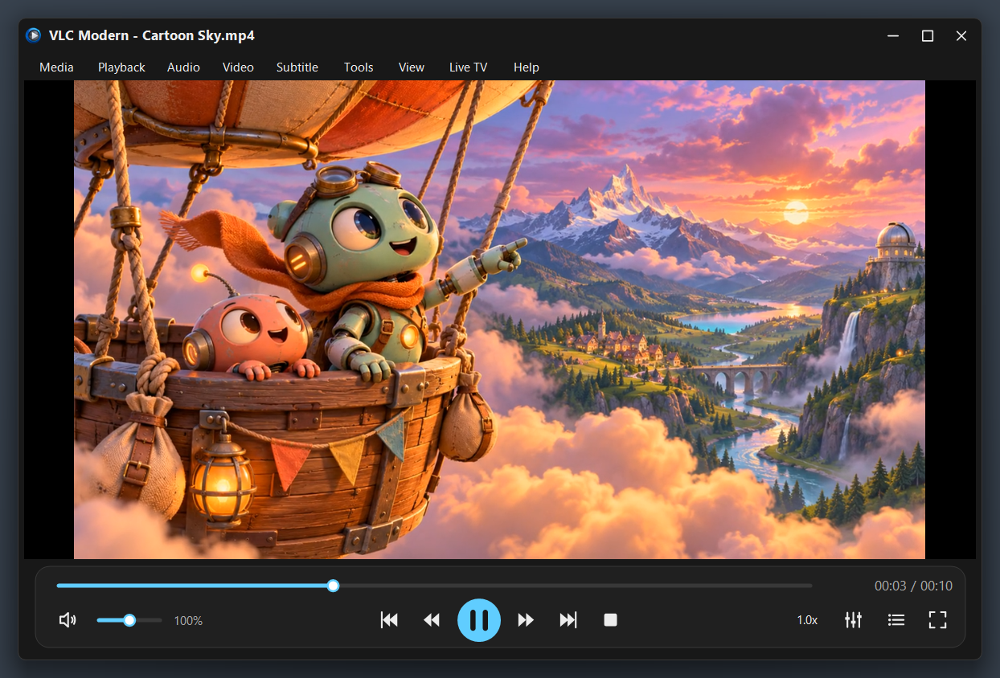
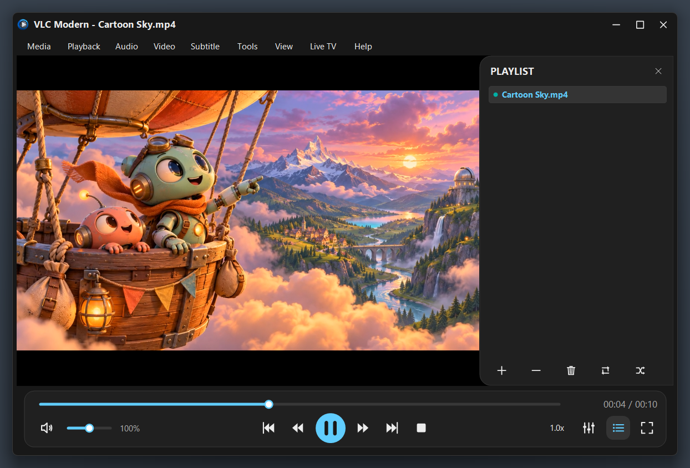
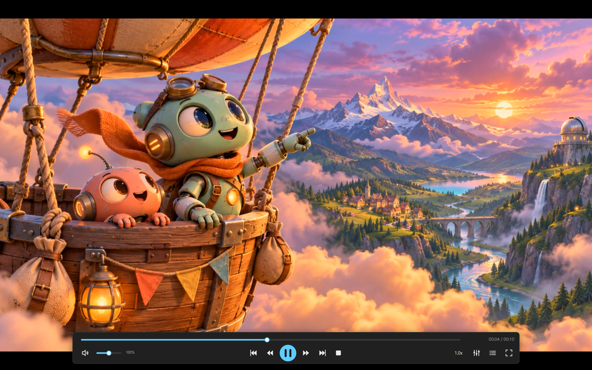
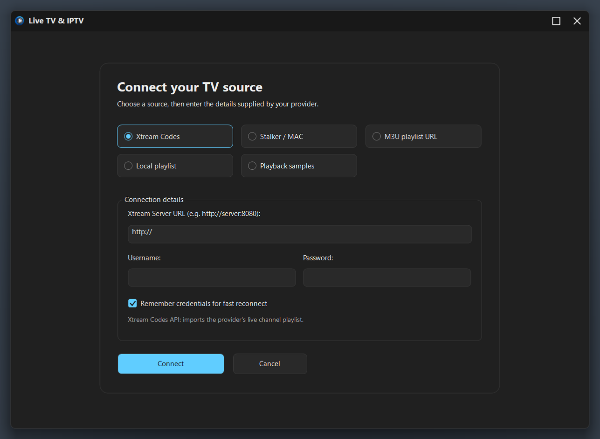

# Screenshot gallery

[← Project home](../README.md) · [العربية](../README_AR.md#صور-البرنامج)

The playback screenshots show *Cartoon Sky*, a demo clip made from original AI-generated 3D-style artwork with an animated camera move.

## Player interface

**Main player.** The video area sits above the seek bar and playback controls, with volume, speed, playlist, and fullscreen actions in the bottom dock.

## Opening media

**Open Media.** Separate tabs cover network streams, discs, and capture devices. The Network tab groups the stream URL and caching options.

## Preferences

**Settings.** The sidebar groups playback, video, audio, subtitles, and network options. The General page brings together window behavior, on-screen messages, and mouse controls.

## Audio and video effects

**Equalizer.** Separate tabs organize audio effects, picture adjustments, and synchronization. The equalizer shows presets, preamp, and per-band gain.

## Playlist

**Docked playlist.** The active item is highlighted, and the panel reserves space alongside the playing video.

## Fullscreen

**Fullscreen playback.** The rounded control dock floats over the video and hides when idle.

## Live TV and IPTV

**IPTV setup.** Choose Xtream Codes, Stalker / MAC, an M3U URL, or a local playlist. The screenshot shows the connection form with empty credentials.
